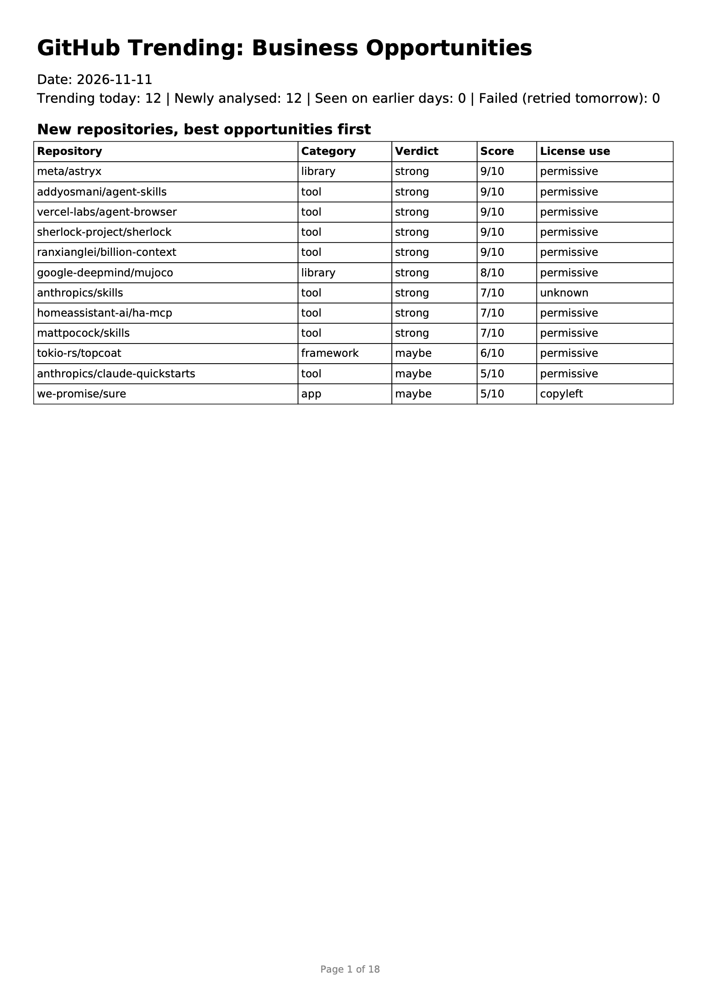
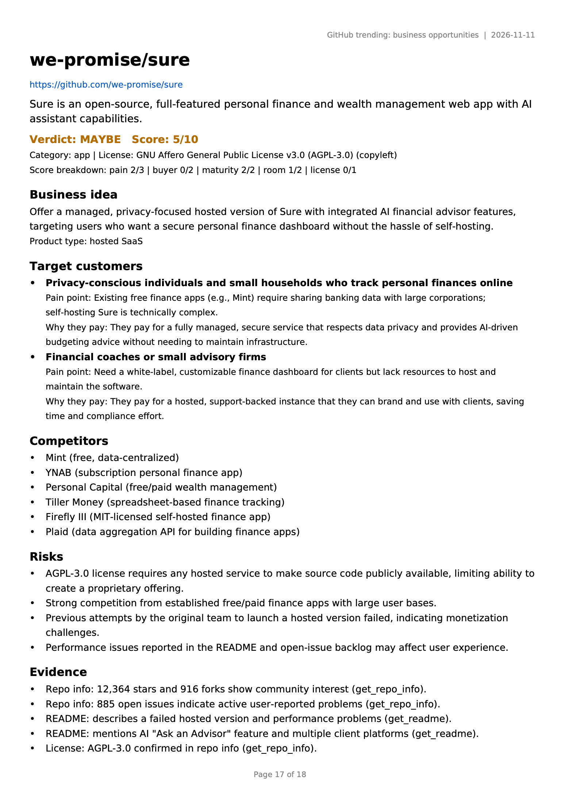
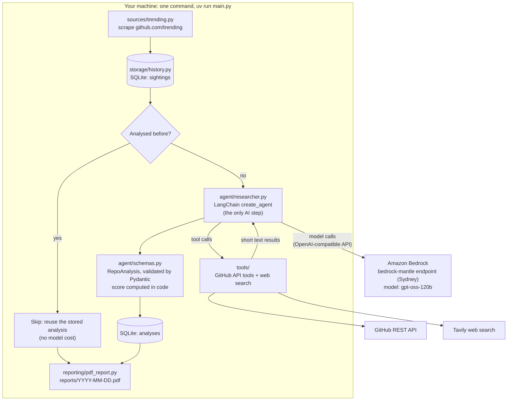
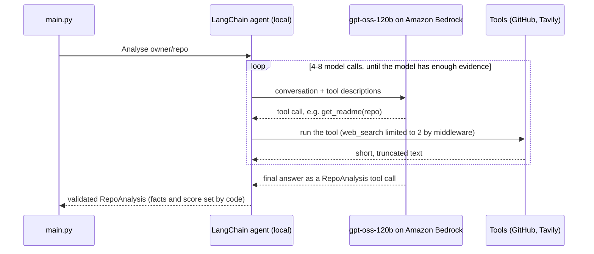

# GitHub Research Agent

A tool-calling AI agent that reads **GitHub Trending** every day, researches each new repository, and writes a **PDF report** on whether a real business could be built on top of it, and who would pay for it.

It checks the license before anything else, looks for competitors that already sell the idea, scores every repository with a strict rubric, and remembers what it has already analysed, so each day only new repositories cost model calls.

<p align="center">
  
  &nbsp;
  
</p>

<p align="center"><em>A real report from 2026-11-11 (<a href="docs/sample-report.pdf">full PDF</a>). Left: the daily summary. Right: one repository, where the agent flagged an AGPL license and no clear buyer.</em></p>

Built as project 3 of an AI-engineering portfolio, on the theme of **systems with tool calling**.

---

## The use case

Every day, 10–25 repositories trend on GitHub. Some of them are the seed of a product or a company, but finding those means opening each repository, reading the README, checking the license, scanning the issues for real pain points, and searching the web for existing competitors. That's about 15–30 minutes per repository, every day.

This agent does that research automatically, in about 30 seconds and a few cents per repository, and delivers a ranked daily report.

**Who it's for:**

| User | What they get from it |
|---|---|
| **Indie hackers and founders** | Product ideas based on proven developer demand (stars, issues), with the license checked first, so they don't build on code they can't legally sell. |
| **Angel investors and VC scouts** | Early deal flow: open-source projects gaining traction that could become companies (hosted, open-core, enterprise support). |
| **Consultancies and agencies** | Projects where businesses will soon need hosting, integration or support, which are services they can sell. |
| **Product and developer-relations teams** | A daily view of which tools developers are adopting in their market, and who is already competing. |

**The ultimate goal** is a scheduled daily "opportunity digest" in your inbox: what's new on GitHub, which projects could become businesses, who would pay, and what the risks are, with every claim linked to evidence.

---

## How it works

### System diagram



**Only one step is an agent.** Scraping, the history check, saving and the PDF are plain Python, because they always happen the same way. The model is used only where real decisions are needed: which files to read, what to search for, and how to judge the opportunity. That keeps the system cheap, testable and predictable.

### The agent loop for one repository



The **agent loop and the tools run locally**. Only the **model calls** go to Amazon Bedrock. (This doesn't use the "Amazon Bedrock Agents" service; the agent is a LangChain agent.)

### What the agent can use

| Tool | Source | Why the agent needs it |
|---|---|---|
| `get_repo_info` | GitHub REST API | Stars, activity and the **license**: can the code be used commercially? |
| `get_readme` | GitHub REST API | What the project does and who it is for |
| `list_files` / `read_file` | GitHub REST API | How it's built (Dockerfile, API, CLI, packaging) |
| `get_recent_issues` | GitHub REST API | The most-discussed issues, as evidence of real pain points |
| `web_search` | Tavily | Whether companies **already sell** the idea |

### What each repository gets

The agent's final answer must fill in a Pydantic model (`RepoAnalysis`): a one-line summary, category, license and commercial-use class, a **score breakdown** (pain 0-3, buyer 0-2, maturity 0-2, room to compete 0-2, license 0-1), business idea, product type, target customers (segment, pain point, why they'd pay), competitors, risks, and **evidence with sources**.

The **score and verdict are not chosen by the model**. Code adds up the breakdown (7+ strong, 4–6 maybe, 3 or less none) and applies rubric rules, for example "room to compete is at most 1 if competitors exist".

---

## Why Amazon Bedrock, and why the `bedrock-mantle` endpoint

**Why Bedrock:** the project runs on an AWS account, so model access goes through AWS IAM (no separate AI-vendor API keys), is billed to the same account and covered by its credits, and the model can be swapped by changing one model ID.

**Why the mantle endpoint:** this choice came out of a real problem, documented here because it's a common trap with new AWS accounts.

1. **The original plan** was Amazon Nova 2 Lite through Bedrock's standard **`bedrock-runtime`** endpoint (the Converse API).
2. On a **brand-new AWS account** (Free plan), every call failed with `ThrottlingException: Too many tokens per day`, **even a 20-token test**. Service Quotas showed why: **every per-model quota was 0**. AWS can set new accounts below the default quotas until they build up usage history.
3. Changing region didn't help. In us-west-2 the quotas even *displayed* the full defaults (11.5 billion tokens/day for Nova 2 Lite), yet calls were still throttled, so the block was account-wide. A quota-increase request was declined: *"model access … may depend on account history and usage patterns."*
4. AWS's quota documentation points out that Bedrock has **two inference endpoints, `bedrock-runtime` and `bedrock-mantle`, each with its own per-model quotas**. On mantle, the account's open-weight models worked immediately, in the account's home region (Sydney).
5. **All 7 open-weight models tested on mantle made correct tool calls.** `openai.gpt-oss-120b` was chosen: it's built for agent and tool use, answered in under 3 s, and is among the cheapest options.

**How it's wired:**
- Mantle speaks the **OpenAI-compatible API**, so the model is LangChain's `ChatOpenAI` with `base_url="https://bedrock-mantle.ap-southeast-2.api.aws/v1"`. Requests go to AWS, not to OpenAI.
- **No long-lived secret:** at the start of each run, `aws-bedrock-token-generator` turns the IAM user's normal AWS credentials into a **short-term Bedrock token** (valid for 12 hours at most).
- The IAM user needs the AWS-managed policy **`AmazonBedrockMantleInferenceAccess`**.
- Switching back to Nova on `bedrock-runtime` once the account's quotas open is a change in `agent/llm.py` and `config.py` only. The agent, tools and pipeline stay the same.

---

## Design decisions

| Decision | Why |
|---|---|
| **Plain code for fixed steps; an agent only for research** | Cheaper, testable, predictable. Using an agent where a function would do adds cost and randomness. |
| **Tools return short text and never raise** | The model reads text. An error like `ERROR: not found (404)` lets the agent recover (e.g. call `list_files` instead); an exception would crash the run. |
| **Tool output is truncated** (README 8k, files 4k characters) | Every character is sent back to the model on every later call. |
| **Limits are enforced in code, not just prompted** | `ToolCallLimitMiddleware` caps the paid `web_search` at 2 per repository (the model tried more than once). A recursion limit (40) stops endless loops. `max_tokens` caps each answer. **The prompt guides; code guarantees.** |
| **Structured output** (`response_format=ToolStrategy(RepoAnalysis)`) | Free text can't be stored, sorted or checked. Pydantic rejects invalid answers (unknown verdicts, out-of-range scores). |
| **The model judges, code computes** | In testing, the model's total didn't match its own breakdown (*"…= 7 (adjusted to 6)"*). Now it only gives the five sub-scores; `@computed_field` adds them up and a `model_validator` enforces rubric rules. |
| **Facts come from code, not the model** | The repository name and the license are overwritten with the exact values from GitHub after the agent answers. |
| **License first** | MIT/Apache/BSD = permissive; GPL/AGPL = copyleft (limits hosted or closed products); none = the code can't legally be reused, so the score is capped at 3. |
| **SQLite memory** (`sightings`, `analyses`) | Repositories analysed on earlier days are skipped (no model cost) and listed in a "seen on earlier days" appendix with how long they've been trending. |
| **Safe to re-run** | `INSERT OR REPLACE`; a same-day re-run reuses that day's analyses instead of redoing them; failed repositories aren't saved, so they're retried automatically. |
| **Dependency injection for the analyser** | `run(analyse, …)` doesn't care how a repository is analysed, so the pipeline can be tested without the model and the model can be swapped freely. |

---

## Project structure

```
github_research_agent/
├── main.py                  the daily run: trending → history → agent → save → PDF
├── config.py                settings: model, region, limits, paths (loads .env)
├── sources/
│   └── trending.py          scrape github.com/trending (requests + BeautifulSoup)
├── tools/
│   ├── github_tools.py      5 GitHub API tools (@tool)
│   └── search_tools.py      web_search (Tavily), short results
├── agent/
│   ├── llm.py               ChatOpenAI → Amazon Bedrock mantle (gpt-oss-120b)
│   ├── schemas.py           RepoAnalysis, ScoreBreakdown, TargetCustomer (Pydantic)
│   └── researcher.py        the LangChain agent: prompt, tools, middleware, structured output
├── storage/
│   └── history.py           SQLite: sightings, new-vs-seen split, saved analyses
├── reporting/
│   └── pdf_report.py        the PDF report (fpdf2)
├── assets/fonts/            DejaVu Sans (Unicode font for the PDF)
├── docs/                    sample report and README images
├── data/                    history.db (gitignored)
└── reports/                 daily PDFs (gitignored)
```

---

## Setup

**You need:**
- Python 3.12 and [uv](https://docs.astral.sh/uv/)
- An AWS account with an IAM user that has the **`AmazonBedrockMantleInferenceAccess`** policy, configured locally with `aws configure` (region `ap-southeast-2`, or another region where mantle offers the model)
- A **GitHub fine-grained token** (public repositories, read-only): 5,000 API requests/hour instead of 60
- A **Tavily API key** (the free tier has 1,000 searches a month)

```bash
git clone <this-repo-url>
cd github_research_agent
uv sync

cp .env.example .env        # then fill in GITHUB_TOKEN and TAVILY_API_KEY
aws configure               # AWS keys stay in ~/.aws, never in .env
```

**Check each part on its own** (every module has a smoke test):

```bash
uv run python -m sources.trending        # today's trending repositories
uv run python -m tools.github_tools      # the tools, with errors returned as text
uv run python -m tools.search_tools      # one web search (1 Tavily credit)
uv run python -m agent.llm               # one model call through Bedrock
uv run python -m agent.schemas           # computed score, validation errors
uv run python -m storage.history         # memory across two simulated days
uv run python -m reporting.pdf_report    # reports/sample.pdf
uv run python -m agent.researcher sherlock-project/sherlock   # one full agent analysis
```

## Usage

```bash
uv run main.py --limit 2     # a cheap test: research only 2 new repositories
uv run main.py               # the full daily run
```

The log shows each repository's verdict, the tools used, the tokens spent and the time taken:

```
14:50:04 INFO    Trending: 12 | new: 2 | done earlier today: 10 | seen on earlier days: 0
14:50:04 INFO    [1/2] researching ranxianglei/billion-context
14:50:31 INFO        ranxianglei/billion-context: strong 9/10 | tools: get_repo_info, get_readme, list_files, read_file, web_search, RepoAnalysis | 6 model calls, 23,698 in + 2,376 out tokens | 27s
...
14:50:58 INFO    Done in 57s: 12 in report, 0 failed, 0 seen before. Report: reports/2026-11-11.pdf
```

The report is written to `reports/YYYY-MM-DD.pdf`. Run it again the same day and it reuses that day's work; run it tomorrow and today's repositories move to "seen on earlier days".

---

## Cost and performance (first full day, 12 repositories)

| Per repository | Typical |
|---|---|
| Time | 15–45 s |
| Model calls | 4–8 |
| Input / output tokens | ~10–35k / ~2–3k |
| Tavily searches | 0–2 (enforced in code) |
| GitHub API requests | ~5–8 |

A full first day used about 250k input tokens, roughly a few cents at Bedrock's on-demand prices for gpt-oss-120b (check current pricing). Later days are cheaper, because repositories analysed before are skipped.

---

## Known limitations

- **Scores run too high.** On the first full day, **9 of 12 repositories came out "strong"** and none "none", even though the prompt says strong should be rare. Three were collections of prompt/skill files that the model labelled "tool" rather than "list", so the cap for lists never applied. The rubric and computed score make each score **consistent and explained**, but the model's judgments are still generous.
- **Scores vary between runs.** The same repository scored 7–9 (sherlock) and 6–9 (mujoco) across runs. Causes: sampling (temperature 0.2), and different search queries returning different evidence.
- **gpt-oss quirks, handled in code:** it sometimes writes the final JSON as text instead of calling the `RepoAnalysis` tool (a fallback extracts and validates it), and it sometimes calls a non-existent `search` tool (the prompt lists the allowed tools).
- **GitHub Trending has no API.** The page is scraped, so a layout change would break `sources/trending.py`. It fails loudly instead of returning an empty list.
- **License detection is GitHub's.** "NOT DETECTED" can mean licenses inside sub-folders. The output is a research aid, **not legal advice**.
- It runs locally, on demand (or from cron).

## Roadmap

- **Evaluation:** label these repositories by hand, measure how often the agent agrees, and compare prompts and models with numbers instead of impressions.
- A **code rule for Markdown-only repositories** (GitHub's languages API), so prompt and skill collections are capped as lists.
- **Compare models** on the same day's repositories: Qwen3 235B and DeepSeek V3.2 on mantle, and Nova 2 Lite on `bedrock-runtime` once the account's quotas open.
- Re-analyse a repository after N days, or when its stars jump.
- Tracing (LangSmith) to inspect every agent step.
- **Deploy to AWS:** Lambda + EventBridge Scheduler for the daily run, S3 for reports, and SES to email the digest.

---

## What I learned

- **Prompt for guidance, code for guarantees.** Every time the model was "asked" to do something important (limit searches, add up a score, use the right tool name), testing showed it sometimes didn't. Each of those became code.
- **Agents are mostly ordinary software.** The model is one component. Most of the reliability comes from the parts around it: truncation, validation, limits, memory, and retries that are safe to repeat.
- **Middleware costs steps.** LangChain middleware adds a graph step to every round, so the recursion limit had to go from 25 to 40.
- **New cloud accounts have hidden limits.** "Too many tokens per day" on a 20-token request meant zero quotas, not heavy usage. A throttle error means the request reached the service; reading the account's actual quotas found the cause, and a second endpoint with separate quotas worked around it.
- **You can't prompt your way to good judgment; you have to measure it.** That's the next step.

---

## Tech stack

| Area | Tools |
|---|---|
| Agent | LangChain 1.x (`create_agent`, `@tool`, `ToolCallLimitMiddleware`, `ToolStrategy`), LangGraph |
| Model | `openai.gpt-oss-120b` on Amazon Bedrock (`bedrock-mantle`), `langchain-openai`, `aws-bedrock-token-generator` |
| Data | GitHub REST API, GitHub Trending (requests + BeautifulSoup), Tavily search |
| Validation | Pydantic v2 (`computed_field`, `model_validator`) |
| Storage | SQLite (Python standard library) |
| Report | fpdf2, DejaVu Sans |
| Tooling | Python 3.12, uv |
